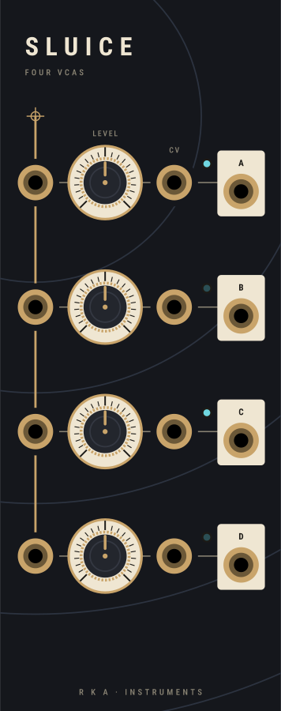

# Sluice: design

Date: 2026-11-15. Status: approved by the user, after a
reviewer's check. The panel is not final: the user has panel
questions and suggestions to bring when that step comes (see "Panel").

Sluice is four voltage-controlled amplifiers, 10 HP, in the Instrument
look. It is the fourth `rka` module and the first of the 37 ideas in
`docs/future/` to be built (first in `docs/future/ROADMAP.md`).

## Intent

The user makes dark, space and horror ambient in VCV Rack. Until now the
collection has had no way for a CV to control loudness. Sluice fills that
gap, and it was put first because it is the simplest DSP on the list, so
it is the right first module to build new in the Instrument look.

How the user will use it: CV inputs driven mostly by LFOs (Sway, later
Neap), with drones, VCOs and other audio passing through. It must also
work with CV passing through, for these cases:

- **Modulation depth under CV.** Sway into a Sluice input, a slow LFO or
  Watch into its CV. A wobble on Fathom's filter fades in and out over
  minutes.
- **Gating a modulation.** An envelope on the CV lets an LFO through
  only during a section.
- **Staggered layers.** One LFO fed down the rope to all four rows, each
  row opened by its own CV at a different time.

## Goals, non-goals, anti-goals

Goals:

- Four DC-coupled VCAs, exact enough on CV to be used as a modulation
  depth control.
- An LFO patched into a row's CV makes that row breathe around where
  Level is set, whether the LFO is bipolar or unipolar.
- Four rows mix to one cable without a mixer.
- Polyphonic throughout; a two-voice cable is a stereo signal.
- Tight: 10 HP, as the mockup.
- All the testing rules in `TESTING.md` from the start, not as a later
  upgrade.

Non-goals:

- **Stereo features.** No L/R pairs and no link between rows. The manual
  shows two patches instead (see "Stereo").
- **AC coupling or a DC blocker.** It would stop Sluice working on CV,
  and an offset is better removed once at the end of the chain. Noted for
  Ballast and Plimsoll (see "For later modules").
- **Per-row Lin/Exp.** One switch serves the whole module. A patch that
  needs both curves uses two Sluices (the user's ruling: "this is VCV
  Rack ... we can simply duplicate the module").
- **Gain above unity, and clipping or saturation.** Keeping the output
  safe is Plimsoll's job.
- **CV attenuverters.** The LFO's own amplitude sets the depth.

Anti-goals, which would make it a failure even if it works:

- A row that moves when nothing is patched into its CV.
- Zipper noise or clicks when Level is turned.
- An envelope on the CV that is softened on its way through.
- Hidden state that changes what a row does without any sign on the panel.

## Behaviour (decided with the user)

Per row n (A, B, C, D, top to bottom):

- **Level and CV add** (the user picked this over "Level scales the CV").
  Each voice's gain position is `p = clamp(Level + CV / 10 V, 0, 1)`, and
  its gain is `curve(p)`. 10 V of CV covers the whole Level travel, so with
  Level at noon a ±5 V LFO sweeps the row from closed to fully open, and
  with Level at 0 a 0–10 V envelope works like a classic VCA. When the
  sum leaves [0, 1] the swing flattens at the end it passes; that is
  expected.
- **An unpatched CV is 0 V.** CV does *not* follow the rope (the user:
  "principle of least surprise"). Only Level sets an unpatched row.
- **The rope (inputs normal downward).** An unpatched input takes the
  *input* signal of the row above, before that row's gain, including its
  channel count. Row A's unpatched input is silence (*designer's call*:
  see "Decided by the designer").
- **Mix downward (outputs normal downward).** If row n's output is not
  patched, its signal (its own VCA output, plus anything already carried
  down to it) is added into row n+1's output. A patched output breaks the
  chain there: it carries its own signal and whatever was carried down
  into it, and nothing more goes past it. With only D patched, D carries
  all four rows. With every output patched, each row is separate.
- **DC-coupled.** Nothing filters the signal; a CV comes through exactly.
- **Response: one Lin/Exp switch on the panel** for all four rows.
  - Lin: `curve(p) = p`.
  - Exp: a decibel taper, so that a fade sounds even to the ear, which
    reaches true silence at `p = 0` and unity at `p = 1`.
  - Default: Exp, because audio is the main use.
- **Polyphony.** A row has as many voices as its input (after the rope),
  up to 16. A mono CV moves every voice together. A polyphonic CV moves
  voice c with CV channel c. A CV with fewer channels than the input gives
  0 V to the voices beyond its channel count, which is Rack's
  `getPolyVoltage`. A row with no signal still outputs 1 channel at 0 V.
- **Light.** Each row's cyan `JewelLight` glows with that row's gain.

### Stereo

Settled: no stereo features. The manual shows two patches for stereo
sources with separate L and R jacks, such as Fathom (and later Fog and
Wake):

1. **Recommended: VCV Merge → one row → VCV Split.** One Level and one
   CV, so the two sides cannot drift apart and the image cannot lean.
2. **Quick: L into A, R into B, one LFO cabled to both CV inputs**, with
   both outputs patched so A does not mix into B. The two Level dials
   must match; Rack's right-click lets you type an exact value.

## Decided by the designer

The user can change any of these. A builder should treat them as decided.

- **Level range and default** (default set by the user). Level runs 0 to
  1, shown in Rack as 0–100 %. It defaults to **0 %, fully closed**:
  - a CV patched into a new row opens it from silence, so an envelope
    works straight away, and a ±5 V LFO is centred by turning Level up
    to noon;
  - nothing arrives at full level before a knob is touched;
  - the 4× sum from the rope needs every Level turned up.

  A new Sluice is silent until a Level is turned up, as most VCAs are.
- **Exp curve.** The taper is linear in decibels over 60 dB
  (`p = 0.5` → −30 dB) and is multiplied by a short linear ramp to zero
  over the bottom 5 % of travel, so it reaches true silence. Use
  `rka::fastDbToGain` from `src/FastMath.hpp`; no libm on the per-sample
  path. The exact range and ramp may be tuned by ear, keeping these
  properties: monotonic, `curve(0) = 0`, `curve(1) = 1`, continuous, and
  no step where the ramp joins the taper.
- **Smoothing.** The Level knob is smoothed (a one-pole of about 10 ms)
  so turning it never clicks. CV is not smoothed. The Lin/Exp switch is
  applied at once: a jump in level when it is flicked is accepted.
- **Mixing polyphonic rows** (agreed with the user, after a review caught
  that mixing voice by voice puts a mono row on the left only). The mixed
  signal has as many voices as the widest row in it.
  - **A mono row spreads to every voice**, the same way a mono CV does.
    So a mono drone mixed into a stereo row (a two-voice cable) sits in
    the centre.
  - **Polyphonic rows mix voice by voice.** A 2-voice row mixed into a
    4-voice row adds into voices 1 and 2 only.
  - **The cost:** a mono row mixed into a 4-voice chord is in every voice,
    so if that chord is later summed to mono, the mono row is 4× louder.
    The manual says so.
- **The copies add up** (the user: keep it). With the rope and the mix
  downward together, one signal into A with only D's output patched and
  every Level fully open, comes out 4× (+12 dB): four VCAs summed, as Mutable's
  Veils does. Nothing scales the mix down. The manual warns about it
  plainly in its section on the rope.
- **Row A unpatched is silence.** Normalling it to a constant 10 V would
  make each row a manual or CV-controlled voltage source. That is useful,
  but it would mean a row with nothing in it puts out a voltage. It is
  left out, and listed in "For later modules" as an idea.
- **The light** shows how open the row is: the highest `p` among the
  row's voices, before the curve. The two curves agree at both ends, so
  the light means the same in Lin and in Exp. Showing the gain instead
  would put a row at Level 50 % on Exp (−30 dB, still clearly audible)
  at about 3 % brightness, so it would look shut. Taking the highest
  voice means a polyphonic row never looks shut while any voice is open.
- **Hostile values** (NaN, ±inf) on any input, CV or param are replaced
  with 0 where they come in, before the rope or the mix, so they cannot
  spread to other rows.
- **The Level smoother** starts at the saved value, so a patch does not
  fade in when it loads. It settles exactly on its target, so a still
  knob gives an exact gain.
- **Bypass.** Rack's bypass connects each row's input straight to its
  output (`configBypass`), with no rope and no mixing.
- **Saved state.** Params only, with no custom JSON. As with Sway and
  Fathom, there is no golden saved-state image to keep.
- **Release.** Sluice joins the unreleased 2.0.0 entry in `CHANGELOG.md`.
  The plugin has no tags yet, so there is no version bump.

## Approaches

Agreed with the user: there is one sensible way, set by the repo's own
rules.

1. **A Rack-free engine plus a thin module** *(picked)*.
   - `src/sluice/SluiceEngine.hpp` (`rka::SluiceEngine`) takes a frame of
     knob values, port voltages, channel counts and connected flags, and
     returns the four outputs, their channel counts and four light values.
   - `Sluice.cpp` only fills the frame, calls the engine and writes the
     results, as `Sway.cpp` and `Fathom.cpp` do. That gives offline tests,
     and `make bench`, `make libm-calls` and `make engine-globals` from a
     `bench.inc` alone (`TESTING.md`, "Adding a module").
2. **The DSP in `Sluice.cpp`.** Ruled out: breaks `CLAUDE.md` and
   `TESTING.md`, and loses the offline tests.
3. **Rack's SIMD types (`float_4`) for the voices.** Not used: no RKA
   module uses them, and a VCA is one multiply per voice, so the gain
   would not show. A plain loop, as in Sway.

Curve calls use `fastDbToGain`, and are recomputed only when a row's
`p` changes (it cannot be cached when CV moves every sample, so the bench
busy case covers that path).

## Panel (10 HP)

The starting point is the mockup. The subtitle under the name reads
**QUAD VCA** (the user's ruling; the sketch says "Four VCAs"). Each row is
a straight line from left to right:

- the input jack on the brass rope, which runs down from an anchor at the
  top left through all four inputs;
- the Level dial on a small enamel face. Its scale is **10 divisions with
  no numerals** (the user's ruling: numerals on a face this size are under
  1 mm, too small to read at a normal zoom). The ticks at 0, 5 and 10 are
  drawn heavier, so closed, noon (where a ±5 V LFO is centred) and fully
  open read at a glance. One division is 1 V of CV. The pointer starts
  fully left, at closed;
- the CV jack;
- the light;
- the output on an ivory tile lettered A to D.

One trace joins each row. The Lin/Exp `Toggle2` goes in the free space
beside the title. The foot mark "R K A · INSTRUMENTS" sits at the bottom
and overlaps nothing.

The user has panel questions and suggestions to raise when this step is
reached. They may add or remove controls, not only move them, so the
panel review comes **first** in the plan (*designer's call*). The ids, the
engine's frame, the tests and the manual all come after it. The
generator has no primitive for drawing the rope yet; adding one is part
of the panel work.
Everything about the panel here is provisional. Settled by earlier
rulings and not to be reopened: the 10 HP width, chosen because at 8 HP
the CV jacks overlapped the Level dials; clockwise for more; the foot
mark rule; no stock components; and everything `gen_panels.py` checks.

The generator's trace rule (a CV input with an attenuverter must be
traced through it) does not apply, because there are no attenuverters.
The row trace and the rope are drawn as the mockup draws them, as long as
the generator's clearance checks pass.

## Code and files

Follows `README.md` "Adding a module" and `TESTING.md` "Adding a module".

- `Makefile` `MODULES` gets `sluice`.
- `tools/gen_panels.py` gets a `PANELS` entry with `dir="sluice"`. Run
  `make panels`, which writes `res/sluice/`, `res-src/sluice/` and
  `src/sluice/SluiceLayout.hpp`.
- `src/sluice/SluiceEngine.hpp`, `Sluice.cpp`, `test_*.cpp` and
  `bench.inc`.
- `src/plugin.hpp` and `src/plugin.cpp` register `modelSluice`.
- `plugin.json` gets slug `Sluice`, a description starting "Quad VCA",
  and tags "VCA", "Mixer", "Polyphonic" and
  "Utility". The slug never changes after release.
- `docs/sluice/README.md` holds the manual, with the two stereo patches,
  the rope, the mix downward, how polyphonic rows sum, and a plain
  warning that rope copies add up (4× with every Level fully open). It is linked
  from the table in `README.md`.
- `CHANGELOG.md`.
- `docs/future/README.md` and `ROADMAP.md`: mark Sluice as built.
  `docs/future/sluice.md`: point to this design.

Param, input, output and light ids are pinned from the first build and
never reordered: four `LEVEL` params plus `CURVE`, and four each of
`IN`, `CV`, `OUT` and the light. The exact names are left to the builder.

## Testing

Everything in `TESTING.md` applies. Specific to Sluice, each test must be
shown to fail first:

- **Exactness on CV.** With Lin, Level 50 % and no CV, a DC input comes
  out at exactly half. Through the full range, the output matches an
  independently written `in × clamp(level + cv/10, 0, 1)`.
- **The Exp curve.** `curve(0) = 0` and `curve(1) = 1`. The curve is
  monotonic over a dense sweep, continuous where the ramp joins the
  taper, and within a stated tolerance of the dB formula above the ramp.
- **Level plus CV.** A ±5 V sine with Level at 50 % reaches both 0 and
  full. A row whose CV is unpatched does not move, whatever the other
  rows' CVs do.
- **The rope.** It carries the signal and channel count down, and a
  patched input breaks it.
- **Mix downward.** Test every pattern of patched outputs (16 cases):
  each output carries exactly the rows the rule says. A mono row spreads
  into every voice of a wider row, and polyphonic rows of different
  widths mix voice by voice. One input down the rope into all four rows,
  mixed into D with every Level fully open, comes out at exactly 4×. A
  new Sluice, at its defaults, is silent.
- **Polyphony.** A mono CV broadcasts; a polyphonic CV maps voice by
  voice; a short CV gives 0 V to the extra voices; 16 voices work.
- **Smoothing.** A step in Level produces no step at the output, and
  settles to within 1 % in a stated time. A step in CV passes through on
  the same sample.
- **Hostile input.** NaN and ±inf on inputs, CV and params do not escape
  as NaN into other rows or the mix. Sample-rate changes keep the
  smoothing time.
- **Bench.** Idle, outputs, and busy (16 voices on every row, a moving CV
  on every row, Exp, so the curve is computed every sample). Budgets are
  set from measurement, as `TESTING.md` says. There is a libm case with
  the knobs still.
- `make test`, `make`, `make smoke`, and a look at
  `build/screenshots/Sluice.png`.

## For later modules

- **A DC blocker** belongs on Ballast's or Plimsoll's output, once, rather
  than in Sluice.
- **Normalling row A to 10 V** would make Sluice a source of manual
  voltages too, and Tackle faces the same question. If it is ever wanted,
  make it a choice that shows on the panel, not a default.

## Left to the builder

- Names of the ids, and the internal shape of the engine's frame.
- The exact smoothing coefficient and Exp ramp width, within the
  properties above.
- Bench budgets, from measurement.
- Final panel positions, after the user's panel review and within the
  generator's checks.
