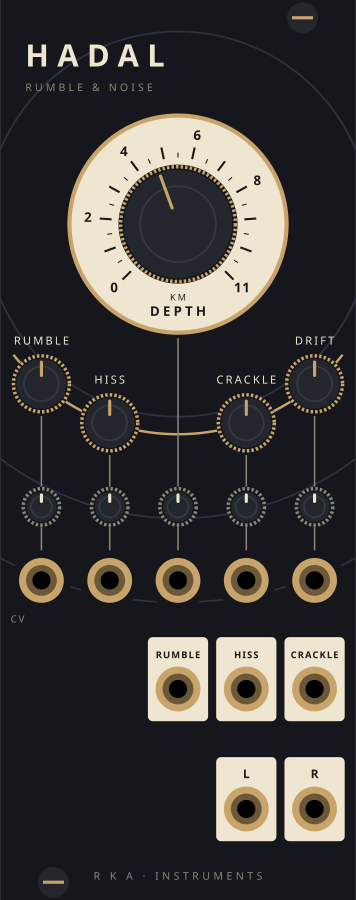

# Hadal: design

Date: 2026-11-16. Status: approved by the user, after a reviewer's
builder check whose two questions are settled as designer's calls.

Hadal is a rumble-and-noise bed, 10 HP, in the Instrument look. It is
the sixth `rka` module and the third of the ideas in `docs/future/` to be
built (third in `docs/future/ROADMAP.md`, after Sluice and Fog).

## Intent

The user makes dark, space and horror ambient in VCV Rack. Hadal is a
background sound source: sub rumble, hiss and crackle that give a track
depth and support. In the user's words, it will mostly **feed other
modules**, not be listened to on its own: rumble into Fog, hiss into
Rigging (the planned resonator bank, which turns noise into a tuned
drone), crackle into a delay, or the whole bed into the mix under a
piece.

The instrument is the hadal zone, the deepest part of the ocean. The
main dial, Depth, is lettered in kilometres from 0 to 11 (about the
bottom of the deepest trench). Deeper is darker.

## Goals, non-goals, anti-goals

Goals:

- Three noise layers (rumble, hiss, crackle), each with its own level
  and its own mono output, plus a stereo mix.
- One gesture (Depth) that darkens the whole bed, by knob or CV.
- Slow, never-repeating movement (Drift), so the bed is never static
  unless asked to be.
- Every control under CV, with an attenuverter.
- Predictable levels, so it is easy to place under a track and to feed
  into other modules.
- All of `TESTING.md` from the start.

Non-goals:

- **An audio input** (to bury another sound in the bed). Fog, Ballast or
  any mixer does that; the user did not ask for one (*designer's call*).
- **Pitch.** Tuned drones are Fathom's and, later, Rigging's job; Hadal
  must not compete with them.
- **Rhythm or events** to trigger other modules. There are no gate
  outputs. Squall (planned) is the random source; its Noise output is a
  plain utility, where Hadal's layers are coloured, finished beds.
- **Presets** in the first release (*designer's call*): the module has
  few enough controls that the defaults are the preset.

Anti-goals, which would make it a failure even if it works:

- **Anything that draws attention.** No audible pitch, ringing, rhythm,
  pulsing or loop. Noise that sounds like a recording on repeat, or a
  rumble that sounds like a note, has failed.
- **Clicks or zipper noise** when a knob or CV moves.
- **Headroom wasted on what nobody hears.** No DC offset, and no energy
  below about 15 Hz, which eats a mixer's headroom and moves speaker
  cones without being heard.
- **Surprises downstream.** A layer output that changes level when an
  unrelated control moves, or fades to nothing as Depth turns.

## Approaches

These were laid out with the user one decision at a time.

**Outputs.**
- **A. Stereo mix only, 8 HP.** One cable pair; the layers are mixed on
  the module.
- **B. Stereo mix plus a mono output per layer, 10 HP.** Each layer can
  go to a different module.

The user chose **B**, because Hadal mostly feeds other modules.

**What Depth does.**
- **1. Depth darkens every layer,** each in its own range. The level
  knobs keep their meaning, and every output follows Depth.
- **2. Depth crossfades the layers:** shallow is mostly hiss and
  crackle, deep is mostly rumble. The level knobs and the layer outputs
  would then change with Depth.

The user chose **1**.

**Stereo against mono mix.** A stereo mix gives width at no cost
(independent noise per side), and it places crackle in space; a mono
mix is one cable. The user chose **L/R, with L carrying the mono sum
when R is not patched**, so one cable gives a proper mono mix and two
give the wide one.

**CV.** The first sketch had CV on Depth only. The user ruled that
**every control gets CV**, so there are five CV inputs, each with an
attenuverter, as on Fog.

## Panel (10 HP)

As the mockup (`2026-11-16-hadal-mockup.svg`); the panel generator
makes the real one.

- **Title** HADAL, subtitle RUMBLE & NOISE, top left, in the house title
  style.
- **Depth**, the main dial at the top: an ivory face with a brass ring,
  ticks every half kilometre, numerals 0, 2, 4, 6, 8 and 11, "KM" and
  "DEPTH" on the face. This is Fathom's main-dial style.
- **Rumble, Hiss, Crackle and Drift** on a graduated limb (Fathom's tick
  marks) curving below the dial, in that order left to right.
- **Five columns below:** an attenuverter row, then a CV jack row with a
  small "CV" label at the left, as on Fog. Each column's trace runs up to
  its control. The middle column's trace runs into Depth.
- **Outputs, all on ivory tiles and right-aligned:** RUMBLE, HISS and
  CRACKLE in a row, then L and R in the lower-right corner beneath them.
  This follows the user's rulings: "L/R need to be lower right corner",
  and the three mono outputs "right aligned as well, but above the L/R".
- **Screws** top right and bottom left, as on every 10 HP panel
  (`screws_at(10, "tr", "bl")`).
- **Clearances:** the generator's checks (clearance, traces, lettering,
  screws) must pass.

## Controls and behaviour

### Depth: how dark (the main dial)

Depth runs from 0 to 11 km. Deeper moves every layer darker and lower,
each within its own range:

| Layer | Shallow (0 km) | Deep (11 km) |
|---|---|---|
| Rumble | a low roar, with energy up to about 120 Hz | a near-subsonic pressure, mostly 20–40 Hz |
| Hiss | bright air, up to about 12 kHz | a dull, muffled roar, up to about 1.5 kHz |
| Crackle | sharp ticks, bright and short | soft, distant thuds, darker and longer |

- **Law:** each corner frequency moves on a log scale with Depth, so
  equal turns give equal changes in octaves.
- **Level stays put as Depth moves.** Each layer's RMS level is held
  within ±1.5 dB across the whole Depth range, so darkening never
  changes a layer's level (*designer's call*: this is what "the level
  knobs keep their meaning" requires).
- **The figures above are starting points for tuning by ear** (see "Left
  to the builder"). The ranges must stay inside the anti-goals: rumble
  never below about 15 Hz, and hiss never brighter than 16 kHz.
- **Default:** noon, 5.5 km.

### Rumble, Hiss, Crackle: levels

- **Each knob is a layer's level:** 0 is silent, full is the layer's
  full level. The law is audio taper (the square of the knob position),
  so the middle of the knob is the musically useful range
  (*designer's call*).
- **One level everywhere:** the knob sets the layer's level both at its
  own output and in the stereo mix. In the mix, each layer arrives
  through a fixed mix gain (*designer's call*: one constant, the same
  for all three layers, below 1). This makes the mix's level proportional
  to each layer output's, without being equal to it. The constant is
  chosen so all three layers at full stay within ±10 V with the soft
  limit idle at defaults. The test compares that fixed ratio, not equal
  voltages.
- **Full level:** at full, Rumble's and Hiss's outputs have an RMS of
  about 1.6 V, so peaks sit near the ±5 V audio standard (noise has a
  high crest factor).
- **Crackle's level** (*designer's call*) is set by energy, not peak,
  because a bed is heard by its energy:
  - At full, Crackle's long-term RMS, at Drift 0 and the nominal density
    of 10 ticks per second, is a stated value, set by ear at the
    listening stop. The starting figure is 0.5 V.
  - *As built:* the ±5 V tick cap and a 0.5 V long-term RMS cannot both
    hold for sparse ticks (about 40 dB crest), so the cap wins. At the
    listening stop the user chose to soft-clip each tick (tanh, drive 3,
    normalised so the largest still reaches 5 V): about 0.1 V RMS at full
    and noon Depth in each side of the mix, 9 dB over plain scaling; the
    CRACKLE jack carries the mono sum of both sides, (L + R) / √2, about
    0.14 V RMS. The ±5 V cap holds at Drift 0; Drift's level wander can
    lift a tick by up to 4 dB (about 7.6 V at full Drift and 0 km).
  - That long-term RMS is what Depth holds within ±1.5 dB (*as built:*
    within 2 dB, because the soft clip squeezes bright, high-peak ticks
    more: -1.6 dB at 0 km, +0.6 dB at 11 km, re noon). Each tick's
    energy stays the same as Depth moves, so a deep thud, being longer,
    peaks lower than a shallow tick.
  - Tick sizes come from a bounded, skewed distribution (mostly small,
    occasionally large), and no tick ever peaks above ±5 V at full.
- **Defaults** (*designer's call*, so a freshly placed Hadal makes a
  usable bed at once): Rumble 0.5, Hiss 0.3, Crackle 0, Drift 0.25.

### Crackle: what it is

- **Sparse random impulses:** short decaying clicks at random times,
  averaging about 10 per second. They are randomly clustered, never
  evenly spaced, so no rhythm forms.
- **Varied loudness:** their sizes follow a skewed distribution, mostly
  small and occasionally larger, like a fire or a settling hull.
- **Depth shapes each tick:** shallow is a bright, very short tick; deep
  is a dark, longer thud.
- **Space:** each tick lands at a random position across the stereo
  field.
- **The Crackle knob sets the ticks' level, not their density**
  (*designer's call*): one control, one meaning. Drift varies the density
  slowly (below).

### Drift: slow movement

- **What moves:** Drift sets how much the bed wanders, over tens of
  seconds. Each layer's level and colour move a little, independently
  on each side, and crackle's density rises and falls. The model is a
  real environment, which is never quite still.
- **At 0** the bed is completely static: steady statistics, nothing
  moving.
- *As built:* level wanders per layer and per side; colour wanders per
  layer, the same on both sides (each layer's filters share one corner).
- **At full:**
  - each layer's level wanders within about ±4 dB;
  - each layer's corner frequencies wander within about ±⅓ octave around
    where Depth sets them;
  - crackle's density varies within about 3–25 per second.
  - These are starting figures for tuning by ear.
- **Pace:** fixed, at time scales of roughly 10–40 seconds. It is a
  smooth random wander (filtered noise, not an LFO), so it never
  pulses, cycles or repeats.

### CV and attenuverters

- **All five controls** (Depth, Rumble, Hiss, Crackle, Drift) have a CV
  input and an attenuverter, with the CV traced up through the
  attenuverter to its control.
- **The law:** control = knob + CV / 10 V × attenuverter, clamped to the
  control's range, as on Fog. With the attenuverter fully clockwise,
  ±5 V from noon sweeps the whole range.
- **Attenuverter default:** 0, so an unpatched or newly patched CV does
  nothing until the attenuverter is turned.
- **Polyphony:** the module is monophonic. A polyphonic CV uses its
  first channel, as on Fog.
- **No zipper noise:** every CV-driven gain and filter change is smoothed
  enough to make no audible steps, even under fast CV
  (*designer's call*). The figure from Fog is 30–40 ms one-poles, or
  per-sample interpolation, whichever the builder finds cleaner.

### Outputs

- **RUMBLE, HISS, CRACKLE:** mono, each carrying its layer at the level
  its knob sets.
- **L and R, the stereo mix:** the three layers, each at its knob's
  level, placed in the stereo field:
  - Rumble is near-centre and mono-safe: the two sides are highly
    correlated (correlation of at least 0.8), because low bass in stereo
    cancels when summed to mono, as Fog learned.
  - Hiss is wide: independent noise on each side.
  - Crackle ticks each land at a random pan position.
- **A patched layer output leaves the stereo mix,** so a layer sent
  elsewhere is not also doubled in L/R. Unplug it and it returns to the
  mix. The change in L/R is exactly that layer's contribution, faded in
  or out over about 10 ms so it does not click (*designer's call*). This is not visible on the panel, so the manual and the outputs'
  hover text must say so.
- **Mono through L:** with R unpatched, L carries the mono sum of the
  mix, at about the loudness of one side of the stereo mix (measured on
  noise). *As built:* (L + R) / √2, exactly one side's loudness on hiss;
  rumble, whose sides correlate at about 0.9, is about 2.8 dB louder in
  mono.
- **Headroom:** with all three layers at full, the mix must stay within
  ±10 V without hard clipping. A gentle soft limit near 8–10 V is
  allowed as a safety net, but at default settings it must never act.
- **Unpatched outputs:** with nothing patched at all, Hadal does no
  work; a layer whose output is unpatched and that is not in the mix is
  not computed (Fathom's pattern).

### Bypass

Bypass silences every output, since Hadal has no input to pass through.

## Code and files

This follows `README.md` "Adding a module" and `TESTING.md` "Adding a
module", as Sluice and Fog did:
- **Engine:** `src/hadal/HadalEngine.hpp` (`rka::HadalEngine`, fed a
  `HadalFrame`, returning a `HadalResult`), Rack-free, with its parts in
  their own headers (noise sources, layer filters, crackle generator,
  drift).
- **Module:** `src/hadal/Hadal.cpp`.
- **Tests:** `src/hadal/test_*.cpp`.
- **Bench:** `src/hadal/bench.inc`.
- **Panel:** an entry in `tools/gen_panels.py` (`res/hadal/`,
  `HadalLayout.hpp`).
- **Manual:** `docs/hadal/README.md`, with `docs/hadal/Hadal.png`.
- **Registration:** `plugin.json` (slug `Hadal`, tags: Noise, Random,
  Ambient, Stereo, or the closest Rack tags), `src/plugin.*`, the
  Makefile's `MODULES`, `tests.mk`, `README.md`'s table, `CHANGELOG.md`,
  and `docs/future/` (the status of `hadal.md`, `ROADMAP.md`).

**Randomness:**
- Every random source is seeded: a seed set on construction, so tests
  are deterministic (*designer's call*).
- Two instances get different seeds, so two Hadals are never identical.
- No `rand()` or other global state; the engine-globals check must pass.

**Real-time rules:** no allocation and no libm per sample (FastMath),
no denormals, NaN-safe comparisons, and filters stable at every sample
rate from 44.1 kHz to 768 kHz, with corner frequencies set relative to
the rate. As on Fog, an unusable rate (non-finite, 0 or below, above
768 kHz) is ignored and the last good rate kept.

## Testing

Everything in `TESTING.md` applies from the start. Specific to Hadal,
with each test shown to fail against a deliberate mutation:

- **Depth darkens each layer.** Each layer's spectral centroid falls
  steadily as Depth goes from 0 to 11, across at least the ranges in the
  table above.
- **Depth does not change level.** Each layer's RMS stays within ±1.5 dB
  across Depth (for Crackle, the long-term RMS at Drift 0).
- **No energy where nobody hears it.** Rumble has less than a stated
  share of its energy below 15 Hz, and no output has a DC offset (mean
  within a stated bound over 10 s).
- **No pitch.** No layer's spectrum has a peak more than a stated
  amount above its smoothed neighbourhood: noise, not tones.
- **No loop or rhythm.** No significant autocorrelation peak in any
  layer, or in crackle's tick times, between 50 ms and 60 s.
- **Levels.**
  - At full, Rumble's and Hiss's RMS is about 1.6 V, and Crackle's
    long-term RMS is its stated value (stated tolerances).
  - No crackle tick peaks above ±5 V at full.
  - Each knob scales its layer by the audio taper.
  - Each layer reaches the mix at the fixed mix-gain ratio to its own
    output.
- **Stereo.** Rumble's L/R correlation is at least 0.8; hiss's is near
  0; the mix's mono-sum loss is at most 3 dB; crackle ticks spread
  across the field.
- **Mono through L.** With R unpatched, L carries the mono sum at the
  stated loudness. With R patched, L is the left mix.
- **Patched layers leave the mix.** Patching a layer output removes
  exactly that layer from L/R, and unpatching restores it, with no
  click.
- **Drift.**
  - At 0, the statistics are stationary: level and centroid steady
    within a tight bound over 60 s.
  - At full, the level and colour wander within the stated ranges and
    never step faster than the smoothing allows.
  - The wander has no periodicity.
- **CV.**
  - The law (knob + CV / 10 × attenuverter, clamped) holds on every
    control.
  - Stepped and square-wave CV on every input causes no step above a
    stated bound in the output's level envelope.
  - A polyphonic CV uses channel 1.
- **Headroom.** All layers at full stay within ±10 V; at defaults the
  soft limit never acts.
- **Hostile input and sample rates.** NaN and ±inf on every CV; sample
  rates from 1 Hz to 768 kHz, 0 and negative. Outputs stay finite and
  bounded, and Hadal recovers its correct behaviour at 48 kHz.
- **Seeds.** One seed gives identical output on reruns, and different
  instances differ.
- **No allocation** in `process()`; no libm per sample (`libm-calls`);
  no global state (`engine-globals`).
- **Seeded fuzz** of all knobs and CVs: outputs finite and bounded.
- **Bench:** idle (nothing patched), outputs (everything patched,
  defaults) and busy (all CVs moving, Drift full). Budgets come from
  measurement; the target is well under Fog's (a noise generator should
  cost a small fraction of a reverb).
- **Smoke screenshot,** and the user's check in Rack. Hadal into Fog is
  the reference patch.

Tuning by ear is part of the work: the plan stops for the user to listen
before the ranges are fixed.

## For later modules

- **Rigging** takes Hadal's Hiss as its main excitation. Its tests can
  use Hadal's engine as a source.
- **Squall's Noise output** stays a plain white or pink utility, with no
  colour or Depth, so the two do not overlap. *2026-11-18: moot; Squall
  was built without a Noise output (`docs/specs/2026-11-18-squall-design.md`).*

## Left to the builder

- The noise colours inside each layer: for example pink against brown
  as the base of rumble, and the filter orders and topologies.
- The exact corner-frequency ranges, Drift ranges and crackle shapes,
  within the stated starting figures and anti-goals, tuned by ear at the
  listening stop.
- The mixing gains that meet the headroom rule, and the mono-sum scaling
  for L.
- The smoothing method for CV (one-pole or interpolation), within the
  no-zipper requirement.
- The test thresholds marked "stated", set from measurement and
  justified in the plan.
