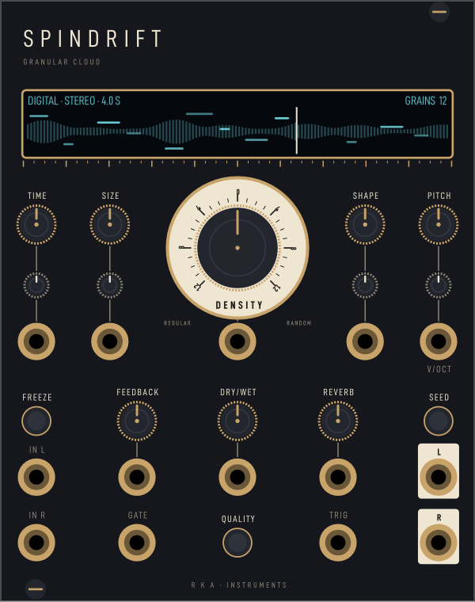
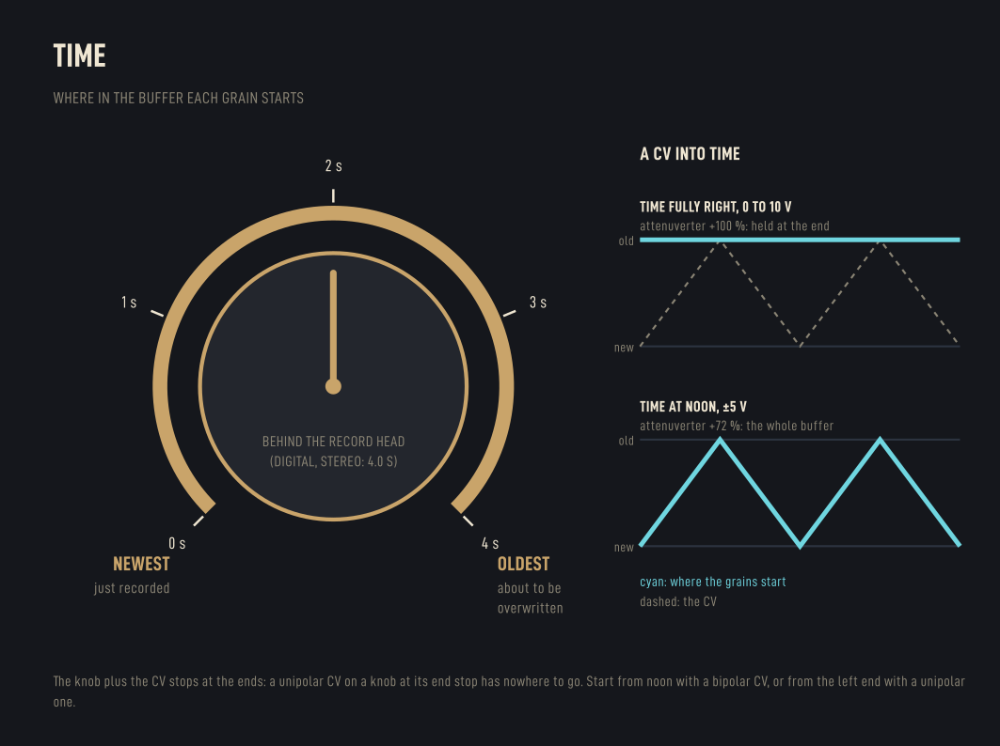
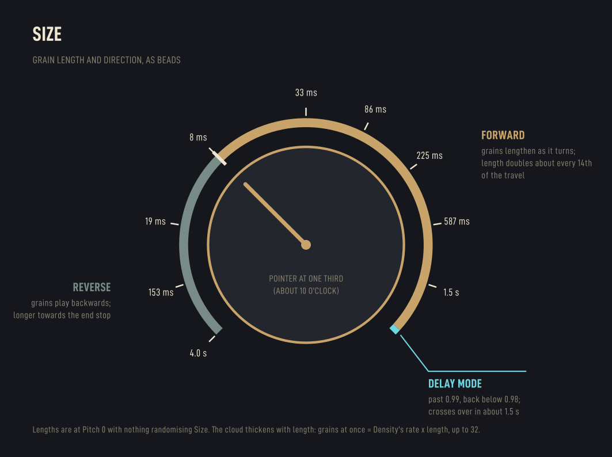
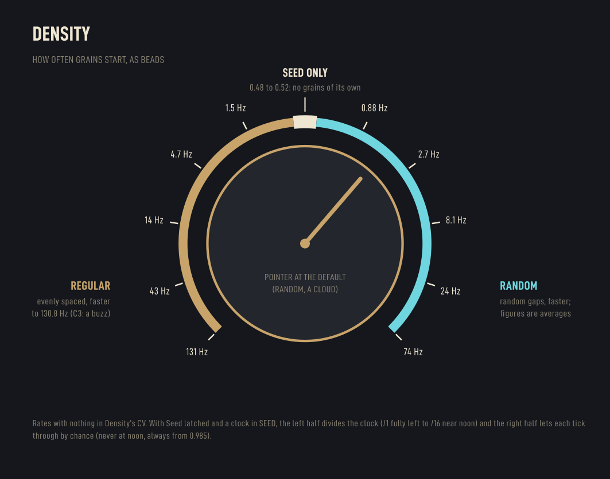
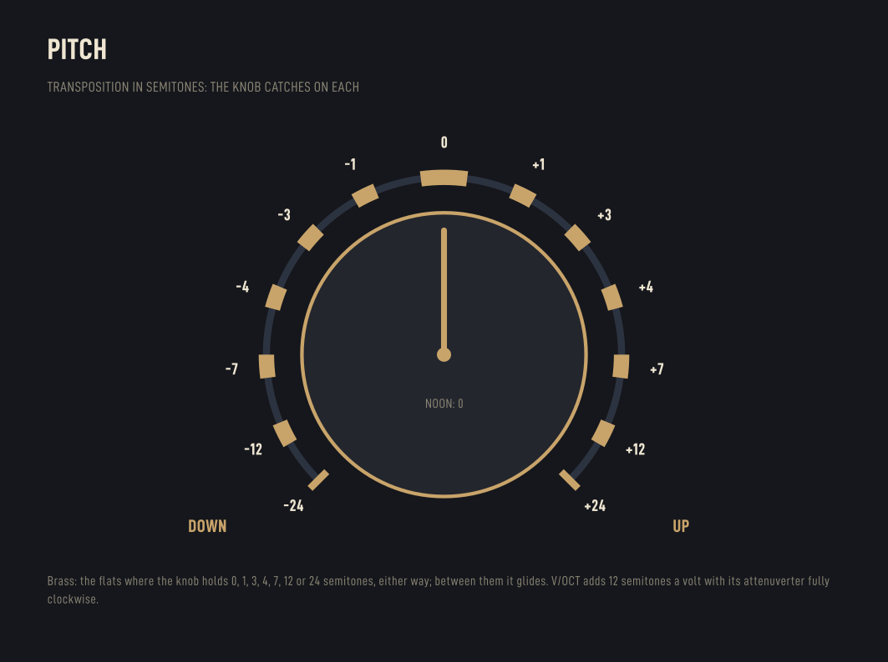
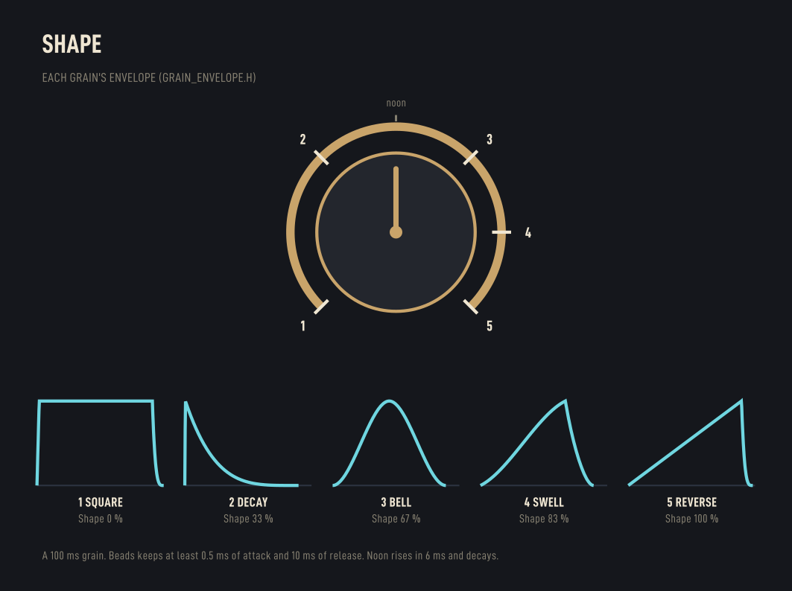
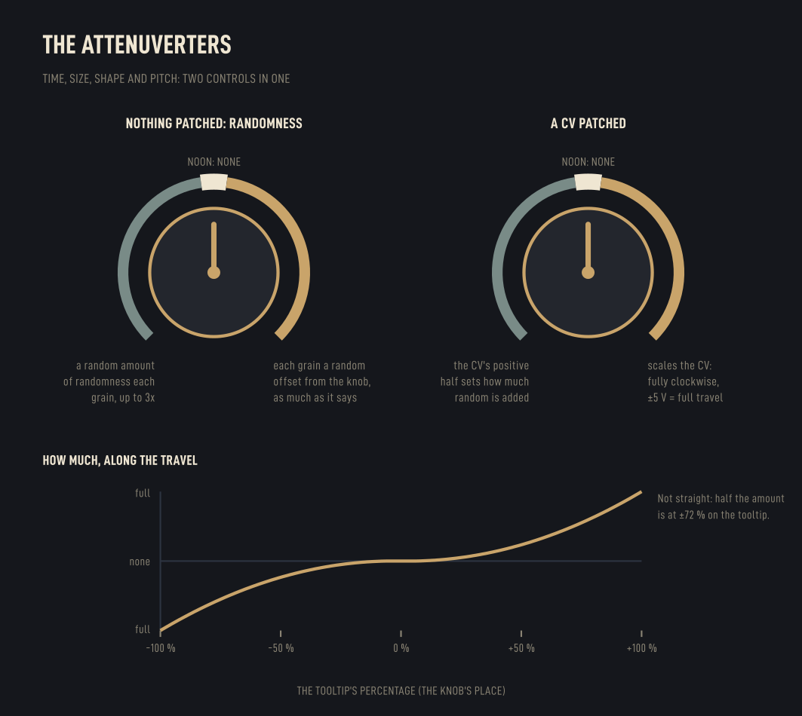

# Spindrift

A granular processor, 20 HP: the spray the wind tears off the crests.
Spindrift is Mutable Instruments Beads, its own code running unchanged
inside an RKA panel. It keeps recording what comes in, a few seconds at a
time, and plays it back as a cloud of grains: short pieces of the
recording, each from its own place, at its own pitch, with its own
envelope. Size fully clockwise turns it into a delay; with nothing
patched into it for 10 seconds it becomes a wavetable synth. A window
above the controls shows the buffer, the record head and every grain.

Anyone who knows Beads can play it without this manual: the controls have
Beads' names and do what they do on Beads: at the same settings, on the
same input, Spindrift's output is Beads' code's output (within a
millionth of a volt at Rack's 48 kHz in Digital, where nothing is
converted). What differs is listed under "Other details".

The diagrams below are drawn by `tools/gen_spindrift_dials.py` from Beads'
own formulas, read from its source. They are dark only, as the panel
picture is.

## The panel

From the top:

- **The window**: the buffer, the record head and the grains, over a
  ruler in tenths (see "The window" below).
- **TIME** and **SIZE** on the left, **SHAPE** and **PITCH** on the right,
  either side of **DENSITY**, the large dial lettered on the Beaufort
  scale: 0 at noon, 4, 8 and 12 each way, REGULAR under its left side and
  RANDOM under its right.
- Under Time, Size, Shape and Pitch, each one's attenuverter, and under
  that its CV jack (Pitch's is lettered **V/OCT**), joined to its control
  by a line. Density's CV jack is under the dial.
- **FREEZE** (a lit button), **FEEDBACK**, **DRY/WET**, **REVERB** and
  **SEED** (a lit button).
- **IN L**, the CV jacks of Feedback, Dry/Wet and Reverb (joined up to
  their knobs) and, on ivory, the **L** output.
- **IN R**, **GATE** (the Freeze gate), the **QUALITY** button, **TRIG**
  (the Seed trigger) and, on ivory, the **R** output.

The numbers on Density's face are a picture of strength, not a unit:
Density has no unit, and its two sides do different things.

## How it works

Everything that comes in is written into a buffer that goes round and
round: Beads' 768,000 bytes of memory, which holds 4 seconds in the
default quality, more in the others (see "Quality"). The newest sound
overwrites the oldest. Density starts grains; each grain picks a place in
the buffer (Time), a length and a direction (Size), a transposition
(Pitch) and an envelope (Shape), and plays that piece once. Up to 32
grains sound at once. Each grain is panned, more widely the more grains
there are and the more random the settings are, and the cloud is kept at
a steady level however many there are (each grain at 1 / sqrt(n)).

**Freeze** stops the recording, so the grains play what the buffer holds
and Time scans a fixed recording. **Feedback** sends the output back into
the buffer. **Dry/Wet** balances the input against the grains, and
**Reverb** is Beads' own.

## The window

The buffer, left to right, as a faint cyan waveform, fixed on the glass;
the record head is an ivory line moving across it, from left to right,
wrapping at the end. The sound just left of the head is the newest, the
sound just right of it the oldest. Frozen, the head stops and the
waveform stays.

- **Each grain** is a short bright dash at the place it is reading, as
  long as the buffer it still has to read, as low as its pan (left at the
  top, right at the bottom) and as bright as its envelope is at that
  moment.
- **Top left**: the quality, STEREO or MONO, and the buffer's length,
  such as "DIGITAL · STEREO · 4.0 S". A quality chosen while frozen shows
  as waiting: "DIGITAL → DIRTY TAPE" (see "Quality").
- **Top right**: "GRAINS" and how many are sounding. The count shown is
  the most that sounded in each 0.2 s, so it can be read; the word stays
  still while the number changes.
- **Delay mode**: "DELAY", the waveform and the head, and a tick for each
  of the delay's taps at its delay, as tall as its gain.
- **The synth**: "SYNTH · BANK" and the bank's number (1 to 12); the
  window draws the wave the voice is playing (its two neighbouring waves
  blended, as the voice hears them) and the grains as dashes at their
  place across the bank. The caption top left shows the quality alone.
- During the 250 ms mute after a change of quality or mode no grains are
  drawn.

The window is only a picture: it has no mouse actions.

## Controls

Every control here is Beads' and does what it does on Beads, through
Beads' own code. The knobs pass through Beads' own smoothing (a one-pole
low-pass at its 4 kHz control rate, so a jump in a knob or a CV takes a
few milliseconds to land).

### Time

Where in the buffer each grain starts: fully left, the sound just
recorded; fully right, the oldest sound in the buffer, about to be
overwritten. In Digital stereo that is 0 to 4 seconds back from the head,
in proportion to the buffer's length in the other qualities.

A grain going forwards at a higher pitch reads faster than the buffer is
written, so Beads starts it far enough back that it does not run into the
record head; a grain going backwards is kept from running round into the
head from behind. Frozen, the head does not move and any place is safe.

### Size

The grains' length, and their direction.

- **From a third of the travel (about 10 o'clock) clockwise**, grains play
  forwards and get longer as the knob turns: from 8 ms at one third to
  about 3.6 s near the end. The length doubles about every 14th of the
  travel (Beads' `ComputeGrainDuration`: 108 semitones of length over
  two thirds of the knob). Noon is 33 ms.
- **Below one third**, grains play **backwards**, and get longer towards
  the left end stop: 4 s fully left. Just under a third (from 0.28 to
  0.35 of the travel) is a flat stretch at the shortest, 8 ms.
- **Fully clockwise, past 0.99** of the travel, Spindrift crosses into
  **delay mode** (below), and back to grains below 0.98. Only the knob
  does this: the Size CV and randomness never enter delay mode.

The lengths are at Pitch 0. A grain is never longer than the buffer
leaves room for: going backwards while recording it travels against the
head at twice its speed, so it is held to half the buffer (2 s in Digital
stereo); frozen, to the whole buffer.

**How thick the cloud is** depends on Size as much as on Density: grains
at once is Density's rate times the grain's length, up to Beads' 32.
Short grains at a fast rate are a buzz with a handful sounding; long
grains at the same rate pile up to 30 or more.

### Density

How often grains start. Density is two controls on one knob, with a dead
centre.

- **Left of noon: regular.** Grains at an even rate, faster as it turns
  left: about 0.64 a second just left of the centre, 1.5 a second at
  0.4 of the travel, 14 at 0.2, and 130.8 a second fully left. That is
  the note C3: the cloud becomes a buzz at that pitch.
- **Right of noon: random.** Grains at random gaps, faster as it turns
  right: on average about 0.36 a second just right of the centre, 1.5 at
  the default (0.65), 24 at 0.9 and 74 fully right. (Beads sets the right
  half to half the left's rate, and its random gaps average a little
  shorter than that: the figures are the long-run averages.) Random
  grains are also spread wider in the stereo field.
- **The centre, 0.48 to 0.52 of the travel:** Density starts no grains of
  its own. With Seed unlatched, each press of Seed or trigger at SEED
  starts one (see Seed).

**Density's CV** (±5 V for the knob's whole travel) moves the knob,
linearly, while the knob is near noon (between 0.275 and 0.725 of the
travel). Further out it becomes exponential, a volt an octave on the
grains' rate (fully so beyond 0.225 and 0.775), so a CV there speeds the
grains up or slows them down evenly. Nothing patched, nothing is added.

**With a clock in SEED** and Seed latched, Density works on the clock
instead:

- left of noon it **divides** it: /1 fully left, then /2, /3, /4, /6, /8,
  /12 and /16 near noon (each about a 17th of the travel);
- right of noon each tick starts a grain **by chance**: never at noon,
  more often as it turns, every tick from 0.985 of the travel up.

On the dividing side, a clock faster than 48 Hz is followed by a timer
locked to its rate rather than tick by tick, so audio-rate clocks work.

### Seed

Seed is **latched at the start**: its button breathes slowly, and grains
come by themselves, at Density's rate. **A press unlatches it**: the
light goes out, and grains then come only while the button is held or the
SEED trigger input is high, at Density's rate. Unlatched, in Density's
dead centre each press or trigger makes exactly one grain. Latched, the
dead centre makes none.

To latch it again, **hold Seed for 4 seconds**, or **press Freeze while
holding Seed** (that press does not freeze). Unlatched, the light is lit
while the button is held or a trigger arrives.

**TRIG** (the SEED trigger input) is read 2.5 ms late, as on Beads (119
frames at 48 kHz, 79 at 32 kHz, 59 at 24 kHz): a sequencer's CVs that
change at the same moment as its trigger have settled by the time the
grain starts. Latched, a signal at TRIG is a clock for Density (above)
and for delay mode.

### Pitch

The grains' transposition, ±24 semitones. The knob catches on 0, 1, 3, 4,
7, 12 and 24 semitones either way (a flat for the first third of each
sixth of its half travel; the 24s only at the end stops) and glides
between them. Its tooltip shows semitones, and a typed value sets the knob
to the middle of that flat.

**V/OCT** adds 12 semitones a volt (±5 V, ±60 semitones) with Pitch's
attenuverter fully clockwise; less with it turned back (see the
attenuverters). Grains going backwards are transposed the same way.

### Shape

The grains' envelope, from Beads' table:

| Shape | Envelope |
|---|---|
| 0 | Square: on at once, held, off at once (a click at short lengths) |
| 1/6 | A half-length hold, then a fall |
| 1/3 | Decay: on at once, falling away |
| 1/2 (noon, the default) | A 6 % rise and a long fall |
| 2/3 | Bell: smooth up and down |
| 5/6 | Swell: up for three quarters, down for a quarter |
| 1 | Reverse: rising all the way, cut off at the end |

Beads gives every grain at least 0.5 ms of rise (2 ms for the square)
and 10 ms of fall, so even the square does not click when grains are
short.

### The attenuverters

Time, Size, Shape and Pitch each have a small knob under them that is two
controls in one, as on Beads.

**With nothing in its CV jack** it sets **randomness**, drawn anew for
every grain. At noon there is none.

- **Clockwise**: each grain's value is taken from somewhere between the
  knob's and a random value across the whole range, the further the more
  it is turned. Fully clockwise every grain is anywhere. (Pitch has no
  ends: each grain gets a random offset, up to ±24 semitones fully
  clockwise, not caught on the knob's intervals.)
- **Anticlockwise**: the same, but each grain also draws how much
  randomness it gets, up to three times the knob: some grains stay near
  the knob, others go far.

In delay mode (Time, Shape and Pitch) and for the synth's voice (Time)
there are no grains to draw for: there the attenuverter makes the
parameter **wander** smoothly instead, by up to as much as it is turned; clockwise the wander is fast,
anticlockwise slow (4 times or a quarter of Beads' rate).

**With a CV in its jack** it is an attenuverter, but only in one
direction:

- **Clockwise** scales the CV: fully clockwise, ±5 V moves the control
  over its whole travel (Pitch: 12 semitones a volt).
- **Anticlockwise** does not invert: the CV's **positive** half sets how
  much randomness is added, so a positive envelope or gate can make the
  grains wilder while it is up. Negative voltages do nothing.

The law is not straight: there is a dead zone at noon (3 % of the travel
either side), and the amount grows slowly at first and fast towards the
ends. Half the effect is at about ±72 % on the tooltip, a quarter at
±52 %.

**A CV on a knob at its end stop.** Knob plus CV stops at the ends of the
control's range. Time fully right with a 0 to 10 V LFO in its CV and the
attenuverter clockwise never moves: the knob is already at the end, and
a unipolar CV can only push it further that way. To sweep the whole
buffer, set Time to noon, the attenuverter part clockwise (about +72 %)
and use a bipolar (±5 V) LFO; or set Time fully left and use the unipolar
one. The same holds for Size and Shape. Their jacks read up to ±8 V; a
CV past that is clipped.

### Freeze

**FREEZE** (the button, which toggles, or the **GATE** input, frozen
while high) stops recording. The grains go on playing what the buffer
holds; Time now chooses a place in a fixed recording, and Feedback has
nothing to write into. The button is lit while frozen by either. Freezing
in delay mode makes the delay a looper (see "Delay mode").

While frozen, a change of quality, a change between mono and stereo (a
cable plugged into or pulled out of IN L or IN R) and the switch into or
out of the synth all wait until Freeze is released, as on Beads, so the
frozen buffer is never cleared under you. A change of Rack's sample rate
while frozen keeps the buffer too: it holds Beads' rate, not Rack's, so
nothing needs clearing.

### Feedback

How much of the output goes back into the buffer with the input, so the
grains are recorded again and the cloud builds on itself. In Digital it
rises with the knob's square, up to three times (one and a half times in
delay mode) through Beads' limiter; in the other qualities it is
soft-clipped, harder the lower the resolution, so high Feedback saturates
rather than running away. What is fed back is high-passed (40 Hz) and a
little darkened at the lower resolutions.

### Dry/Wet

The input against the grains, by Beads' near-equal-power law: at 0 the
input alone, at 0.75 of its level; at 1 the grains alone, at 1.5. At the
default, 0.5, both (the input at 0.56, the grains at 1.13).

### Reverb

Beads' reverb, after Dry/Wet: one knob sets its amount and its decay
together (the amount with the knob's square, the decay with its cube).
It is brighter in Digital than in the other three qualities, and decays a
little longer in those.

### Feedback, Dry/Wet and Reverb CVs

Beads has one CV input and an Assign button to choose its destination;
Spindrift has a CV jack for each instead. Each adds ±5 V for the knob's
whole travel, and does nothing unpatched.

### Quality

See "Quality" below.

## Modes

### Grains

The default, described above.

### Delay mode

Size fully clockwise (past 0.99 of its travel, out again below 0.98).
Beads waits until the knob has been there 1.5 seconds, fading the grains
out over the second half of that wait, then fades the delay in over
0.75 s; going back is the same the other way. The window says DELAY.

The delay reads the same buffer, through Beads' multitap delay. Its time
is built in two steps: a **period**, and a whole number of periods.

**Free** (Seed latched, nothing at TRIG):

- **Density** sets the period: the whole buffer at noon (4 s in Digital
  stereo), shorter either way, halving every 18th of the travel, to
  about 1/512 of it at the ends (7.8 ms in Digital stereo). Its CV works
  as in grain mode, an octave a volt far from noon. Right of noon a
  second tap, at 0.77 of the delay, fades in (fully by 0.54 of the
  travel), its level swaying slowly (a 0.17 Hz sine), so the repeats fall
  into an uneven pattern.
- **Time** sets the delay as 1 to 16 periods (fully left one, fully right
  sixteen), stepping between them with a short crossfade. The delay is
  never longer than the buffer.

**In time** (a clock at TRIG, or Seed unlatched and its button tapped):

- the period is the time between clock ticks, or between taps on Seed
  (up to 4 s; a quarter of a second until two have come);
- **Density** chooses a fraction of it: from noon to the left 1, 1/2,
  1/4, 1/8, 1/16 (fully left); from noon to the right 1, 1/2, 1/3, 1/4,
  1/6, 1/8, 1/10, 1/12, 1/16 (fully right); its CV moves the knob;
- **Time** multiplies that by 1 to 16, as above.

The other controls in delay mode:

- **Shape** shapes each repeat, in time with the period: at 0 the repeats
  are steady; a little up, each falls away (a ramp down); about 0.6, a
  triangle; fully right, each swells and is cut off (a ramp up).
- **Pitch** transposes the repeats (a pitch-shifting read, crossfaded to
  a plain one within 1 % of no transposition).
- **Size's attenuverter** is a tone control on the repeats: noon leaves
  them as they are; anticlockwise low-passes them, darker the further it
  is turned; clockwise high-passes them. The Size CV moves it too.
- The attenuverters of Time, Shape and Pitch make them **wander**
  smoothly (see the attenuverters) rather than jump.
- **Feedback** is the regeneration, up to one and a half times.
- **Freeze** turns the delay into a **looper**: the buffer is cut into
  slices one period (times Density's fraction) long, Time chooses which
  slice plays, and it repeats with Shape as its envelope (around 0.6 two
  overlapping heads crossfade so the loop has no seam).

In gate output mode, R gives a gate with each repeat (frozen, with each
pass of the loop).

### The synth

With **Synth mode** at Automatic (the default, as Beads), Spindrift becomes
a wavetable synth when **neither audio input has been patched for 10
seconds and its output has stayed under 1 % of full scale (0.1 V)** that
whole time. It never does so while frozen, and never when it is first
added: the 10 seconds start then. It goes back to grains the moment a
cable is plugged into IN L or IN R. Each switch mutes the output for
250 ms, and the window says SYNTH · BANK n.

The synth is a wavetable voice and a cloud of wavetable grains, run at
48 kHz, at C3 (130.8 Hz) with Pitch at noon and nothing at V/OCT. The
controls:

- **Pitch** and **V/OCT**: the note, the knob catching as before, V/OCT
  at 1 V an octave whatever its attenuverter, which here sets how far
  the grains' pitch strays at random.
- **Feedback** chooses one of 12 banks of waves (a twelfth of the travel
  each).
- **Time** chooses the wave within the bank, for the voice (its
  attenuverter makes it wander) and for each grain (at random).
- **Density**, **Seed**, **Size** and **Shape**: the grains, as in grain
  mode (below a third Size only lengthens them towards the left end: a
  wave has no backwards).
- **Dry/Wet**: the voice against its grain cloud. The voice alone is
  ±5 V.
- **Reverb**: the synth's own setting of Beads' reverb.
- **Quality**: the bit depth: Digital 16-bit; Vintage Digital 7-bit;
  Clean Tape a 16-bit voice and 6-bit grains; Dirty Tape 4-bit.
- **Freeze**: no new grains, and the sounding ones hold their level and
  go on sounding; the voice's wave stops wandering.

The menu's **Synth mode** can also be **Always** (the synth from the
start, whatever is patched) or **Never** (grains always, even with
nothing patched).

## Quality

The **QUALITY** button steps through Beads' four settings, Digital,
Vintage Digital, Clean Tape and Dirty Tape, and round. A new Spindrift
starts on Digital.

| Quality | Beads runs at | Buffer samples | Buffer, stereo | Buffer, mono |
|---|---|---|---|---|
| Digital | 48 kHz | 16-bit | 4.0 s | 8.0 s |
| Vintage Digital | 32 kHz | 12-bit | 8.0 s | 16.0 s |
| Clean Tape | 24 kHz inside 48 kHz | 12-bit | 10.7 s | 21.3 s |
| Dirty Tape | 24 kHz | 8-bit mu-law, with wow and flutter | 16.0 s | 32.0 s |

The buffer is always the same 768,000 bytes, so the lower the
resolution, the longer it is. **Mono**: with only one of IN L and IN R
patched, Beads runs mono, the patched side feeding both, and the buffer
holds twice as long. The grains are still panned in stereo.

- **Vintage Digital** also quantises the dry input to 12 bits.
- **Clean Tape** soft-clips the input (with the Fixed or Manual gain)
  more as its peaks near full scale, from about 6.8 V.
- **Dirty Tape** runs everything at 24 kHz, the dry signal too (as on
  Beads' hardware), passes the dry input through the same 8-bit mu-law,
  always soft-clips the input (with the Fixed or Manual gain), and adds
  wow and flutter to the whole output.
- **Reverb** is brighter in Digital than in the other three.

Spindrift converts Rack's rate to the rate Beads runs at on the way in
and back on the way out. At 48 kHz in Digital nothing is converted;
otherwise the converters pass the band up to 0.41 of the lower rate (to
about 9.8 kHz in Dirty Tape, 13 kHz in Vintage Digital, 19.7 kHz in
Digital and Clean Tape) and stop everything above half of it. They add
0.25 ms of delay at 48 kHz in Digital, about 1.9 ms at 44.1 kHz, about
2.5 ms in Vintage Digital and about 3.3 ms in Dirty Tape.

**A change of quality clears the buffer and mutes the output for
250 ms**, as on Beads (nothing is crossfaded); the button is lit for those
250 ms. So does a change between mono and stereo, and a change of Rack's
sample rate (frozen, the buffer is kept across a rate change).

**While frozen**, the button still chooses, but the change waits for
Freeze to be released: the window shows it waiting, "DIGITAL → DIRTY
TAPE", and further presses move the waiting choice on.

**A long press (1.5 s)**, on release, does not step the quality: it sets
the input gain to Automatic and starts it learning again, as on Beads
(see "Menu").

## Inputs and outputs

- **IN L, IN R**: audio. **±10 V is full scale** (Beads' hardware), so a
  ±5 V signal sits at half scale with Beads' headroom above it. Louder is
  clipped at ±10 V; the tape qualities soft-clip as it nears that. With one patched,
  Beads runs mono (above); with neither, the synth may take over.
  Polyphonic cables are summed.
- **L, R**: up to ±10 V. Fully dry (Dry/Wet at 0) the input comes out at
  0.75 of its level, as on Beads; the synth's voice alone is ±5 V. With
  **Gate output** on (the menu), L is the mono mix and R a 0/10 V gate
  that rises as each grain starts and stays high for the first half of
  the gap to the next (in delay mode, with each repeat).
- **TRIG** (Seed) and **GATE** (Freeze): gates and triggers, high from
  1 V, low under 0.1 V.
- **The CV jacks**: Time, Size and Shape read ±8 V and the others ±5 V;
  past that they clip. Each is read only when patched, from a polyphonic
  cable's first channel. NaN reads as 0 V and an infinite voltage as
  the jack's limit (at TRIG and GATE a NaN leaves the gate as it was).

## Menu

Right-click the panel:

- **Synth mode**: Automatic (as Beads), Always, Never. See "The synth".
- **Input gain**:
  - **Fixed** (the default): ±10 V is full scale, and louder input is
    clipped (or soft-clipped in the tape qualities) as on Beads at unity
    gain.
  - **Automatic (as Beads)**: Beads' own gain, which listens for a second,
    learns the input's level over the next five and settles where its
    peaks reach 90 % of full scale (up to 40 times, 32 dB), then follows
    it slowly. Unpatching both inputs starts it learning again. The Quality long press chooses this.
  - **Manual**, with the **Manual gain** slider below it: 0 to 32 dB (1 to
    40 times, Beads' range). Moving the slider chooses Manual.
- **Gate output (R: a gate per grain; L: the mono mix)**: Beads' gate
  output mode. Off by default.
- **Keep the frozen buffer with the patch**: on by default; see below.

On Beads these are hidden behind button combinations; here they are in
the menu. Beads' monophonic grains and buffer trim are compiled out of
the firmware Beads ships with, and are left out here too.

## With the patch

Saved: the knobs, the quality, whether Seed is latched, and the menu's
settings.

**The frozen buffer.** With the buffer frozen when the patch is saved (by
the button or the gate) and **Keep the frozen buffer with the patch** on,
the buffer is written into the module's folder inside the patch as
`buffer.bin`: a 20-byte header (the quality, mono or stereo, the record
head's place) and 768,016 bytes of Beads' memory in Beads' own format, so
it comes back to the bit. (Beads' own backup saves 768,000 bytes, which
cuts off the end of the 12-bit ring and the copy of the ring's first
frames that the interpolation reads at the wrap.) It is written when you
save, and only if it has changed since it was last written; Rack's
autosave does not write it.

When the patch opens, the buffer is back before the first sample, and
**Freeze is latched on**, as Beads does after restoring its backup, so a
buffer frozen by the gate is not overwritten when the gate is low. Press
Freeze to let it record again.

Not frozen, or frozen in the synth (see "Freezing the synth" below),
nothing is stored (and an old `buffer.bin` is removed): the
buffer is a moment of input, not a recording. Freeze itself is not kept
apart from the buffer: a patch reopens frozen only when its buffer comes
back with it.

A `buffer.bin` that is missing, cut short, damaged, from a newer format
or of another quality than the patch says loads nothing: the buffer
starts empty and unfrozen, and Rack's log says why. Loading a preset or
undoing onto a running module leaves its buffer as it is.

## Patches to try

- **A cloud from a drone.** Fathom into IN L (mono: 8 s of buffer),
  Density at the default, Size at noon, Time's attenuverter a quarter
  clockwise, Dry/Wet at 0.7, Reverb at 0.5. Then Fog after it.
- **Hold a moment.** Squall's GATE into GATE. Each event freezes what was
  passing, and the grains scatter it until the gate ends; with Squall's
  Weather low the freezes are long.
- **A sweep through the past.** A slow Sway, bipolar, into Time's CV, Time
  at noon, its attenuverter at about +72 %: the grains drift from now back
  to the oldest sound and forward again.
- **Grains on the beat.** A clock into TRIG, Seed latched, Density left of
  noon: grains on every tick, every 2nd, every 4th as it turns. Right of
  noon: a grain on some ticks, more as it turns.
- **A played grain.** Seed pressed once (unlatched), Density at noon, a
  sequencer's gate into TRIG and its pitch into V/OCT: each note plays one
  grain at that pitch, the CV settled 2.5 ms before it.
- **Octaves.** Pitch at +12, its attenuverter a little clockwise, Feedback
  at 0.4: each pass climbs an octave and smears a little more.
- **Dirty echoes.** Dirty Tape, Size fully clockwise (delay mode),
  Density a little right of noon, Feedback 0.6, Size's attenuverter a
  little anticlockwise: dark, wobbling repeats in an uneven pattern.
- **The synth.** Nothing patched for 10 s (or Synth mode: Always), a
  sequence into V/OCT, Feedback to choose a bank, Time's attenuverter a
  little clockwise, Dry/Wet at 0.5 and Density right of noon.

## Bypass

Bypassed, IN L passes to L and IN R to R.

## Other details

- **Where it departs from Beads.** Spindrift starts in grain mode with no
  mute, set for the inputs it first sees (Beads boots silent until its
  input is patched). A jack counts as patched the moment it has a cable
  (Beads' normalisation probe takes a few blocks to decide). The three
  mix CV jacks replace Beads' one assignable CV, each acting only when
  patched. The input gain is Fixed by default (Beads' is automatic). The
  gate output is 0/10 V (Beads' is -8 V). Controls are read once a Beads
  block (a quarter of a millisecond), TRIG and GATE every Beads sample.
- **Short triggers.** TRIG and GATE are read once per Beads sample, so a
  pulse shorter than one (about 42 µs in Dirty Tape) can be missed.
  Rack's usual 1 ms triggers are always seen.
- **Freezing the synth.** Freeze in the synth holds the synth; it does not
  put the synth's sound in the buffer. In synth mode the buffer is not
  kept with the patch, as on Beads (which backs its buffer up only outside
  the synth): saved frozen in the synth, no `buffer.bin` is written (an
  old one is removed), and the patch reopens unfrozen with an empty
  buffer. (A buffer the patch brought back, frozen ever since, is kept as
  it came, whatever mode the module is in.)
- **Initialize** puts the knobs back to their defaults (Density 0.65 and
  Dry/Wet 0.5, so a new module makes a cloud; the rest at noon or 0),
  Seed latched, Digital, Freeze off, and the menu to its defaults.
  **Randomize** moves the knobs only.
- **Instances** each have their own random stream, so two Spindrifts with
  the same settings and input make different clouds.
- **Memory**: about 850 kB per Spindrift, set aside when it is added.
- **Aliasing.** Beads' grains read faster than 1 through a Hermite
  interpolator with no low-pass, its envelopes are audio-rate, and its
  qualities decimate and quantise on purpose: all part of its sound, and
  kept. Spindrift's tests hold it to Beads' own aliasing (within 3 dB;
  worst measured 0.8 dB more); the converters at its edges are the only
  filters added.
- The lettering in the window is D-DIN Condensed, shipped with the plugin
  under its licence (SIL Open Font License 1.1).
- Beads' DSP is © Emilie Gillet, MIT licence (`LICENSE-beads.md`),
  vendored in `src/spindrift/beads/` and `src/spindrift/stmlib/` with
  every change marked.
- CPU, % of one core at 48 kHz on an Apple M-series Mac: 0.25 with
  nothing patched at the defaults, 1.35 with 30 to 32 grains sounding,
  1.39 with every CV moving as well, 0.62 in Dirty Tape, 0.74 in delay
  mode, 0.23 in the synth.
