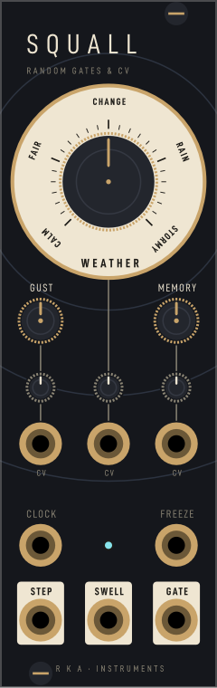

# Squall

Random gates and CV, 8 HP: the weather of a piece. Squall makes **events**
(gates to strike voices, envelopes and resonators) and **drifting CV**
(slow movement for levels, filters, reverb and pan), and both tell the same
story. One dial, **Weather**, sets how much is happening, from one event in
ten minutes to eight a second. **Gust** bunches events into bursts with
calm stretches between, and **Memory** lets the weather repeat itself and
slowly wear the pattern away. It runs free, or locks to a clock.

## The panel

Squall is drawn as an aneroid barometer. From the top:

- **Weather**, the hero, on a barometer face lettered CALM, FAIR, CHANGE,
  RAIN and STORMY.
- **Gust** on the left and **Memory** on the right. Under each of the three
  controls is its **attenuverter**, then its **CV** jack, traced up to it
  (Weather's runs up the middle into the face).
- **CLOCK**, the **event light** and **FREEZE**.
- On ivory tiles: the **STEP**, **SWELL** and **GATE** outputs.

The right-click menu has **Range** and **Loop length** (below).

## Controls

### Weather: how much is happening

Each word on the face is a real rate. Free-running, Weather sets the average
number of events, on a smooth scale between the words:

| Weather | Free-running, on average | Clocked, the chance on each tick |
|---|---|---|
| CALM (fully left) | one event every 10 minutes | 1 in 256 |
| FAIR | about one a minute (72 s) | 1 in 64 |
| CHANGE (noon, the default) | about one every 9 s | 1 in 16 |
| RAIN | about one a second | 1 in 4 |
| STORMY (fully right) | 8 a second | every tick |

Rack's tooltip shows the free-running rate ("1 per 9.0 s"). At Calm,
minutes can pass with nothing happening: **the light flashes on every
event**, so you can see Squall is working.

### Gust: how events bunch up

At 0, events are evenly random: each one is independent of the last, with
no pulse or pattern. Turned up, each event makes another more likely soon
after, so events arrive in **bursts that grow and die away by themselves**,
with long lulls between, the way wind gusts. Gust changes the rhythm, **not
the amount**: over a long stretch, the average is what Weather says. A
burst at Calm lasts minutes; at Stormy, a moment. The default is 30 %, a
little gusty.

With a clock at Stormy and Gust up, the odd tick is skipped: a short lull.

### Memory: whether the weather repeats

Squall remembers its last 16 events: the time between them, their values
and their gate lengths. At each event, Memory is the chance that the next
one is a **replay** of the event a loop's length back, instead of a new
one.

- **0** (the default): everything is new.
- **Around 70 %:** a pattern settles in, recurs, and slowly wears away.
- **100 %:** the last events loop exactly.

**Loop length** (right-click menu) is 4, 8 (default) or 16 events. A fresh
Squall makes new events until it has a loop's worth to replay.

The timing in the memory follows Weather: turn Weather up while a loop is
locked and the loop speeds up, keeping its shape. The loop is **saved with
the patch**, and carries on when a clock is patched or unpatched.

### CV and attenuverters

Weather, Gust and Memory each have a CV input and an attenuverter:
control = knob + CV / 10 V × attenuverter. With the attenuverter fully
clockwise, ±5 V from noon sweeps the whole range; fully anticlockwise
inverts. The attenuverters default to 0. A polyphonic CV uses its first
channel. A slow LFO or a ramp on **Gust** or **Memory** is the way to let a
piece go from steady to stormy, or from wandering to looping, and back.

## Inputs and outputs

- **CLOCK:** patched, events land **only on clock ticks**, with Weather as
  the chance per tick (table above). Unpatched, Squall runs free.
- **FREEZE:** while high, everything holds still: no events, Step holds,
  and Swell slows to a stop over about 20 ms (so it never stops with a
  click) and holds. A gate already high ends at its normal time. On
  release, Squall carries on where it stopped. Clock ticks are ignored
  while frozen.
- **GATE:** 0 or 10 V. Each gate lasts a quarter of the average time
  between events, between 5 ms and 4 s: long at Calm, short at Stormy.
  Into a trigger input it strikes; into Sluice or a slow envelope it holds
  and releases. An event while the gate is high drops it briefly, so every
  event is its own rising edge. With a clock, the length comes from the
  clock's measured period (10 ms until two ticks have arrived).
- **STEP:** a new random value at each event, held until the next. New
  values are spread evenly across the range.
- **SWELL:** a smooth drift through the same values as Step, never
  overshooting and never with a corner. It reaches a new value in about the
  average time between events, so its pace follows Weather: tens of minutes
  per swing at Calm, a second or two at Stormy. In a burst it smooths
  through the quick changes; in a lull it arrives and rests.
- **Range** (right-click menu, for Step and Swell together): **±5 V**
  (default), **0 to 10 V** (for level CVs such as Ballast's or Sluice's),
  **±2 V** or **±1 V** (for small moves: a filter nudge, a slight detune).
  Changing it moves Step at once; Swell glides to the new range.

## Patches to try

- **Distant thunder:** Gate into an envelope, the envelope into a Sluice
  channel carrying Hadal's Rumble, into Fog. Weather near Fair, Gust 60 %.
- **A drone that breathes:** Swell (0 to 10 V) into a Ballast level CV on a
  Fathom drone.
- **Moving room:** Swell into Fog's Bloom or Size CV, attenuverter about a
  third.
- **Wandering pan:** Swell into a Pan CV, one Squall per channel.
- **Beacon that decays:** Gate into a short blip, Memory 100 %, loop of 4;
  then bring Memory down to about 60 %.
- **A storm across a piece:** a very slow ramp into Gust CV and Weather CV.

## Bypass

A bypassed Squall holds every output at 0 V, with the gate low.

## Other details

- NaN or infinite values on any input read as 0 V.
- Two Squalls never make the same weather.
- Squall stores its knobs, the Range and Loop length settings, its memory,
  and where Step and Swell were, so a reloaded patch carries on without a
  jump.
- Squall uses about 0.03 % of a CPU core.
