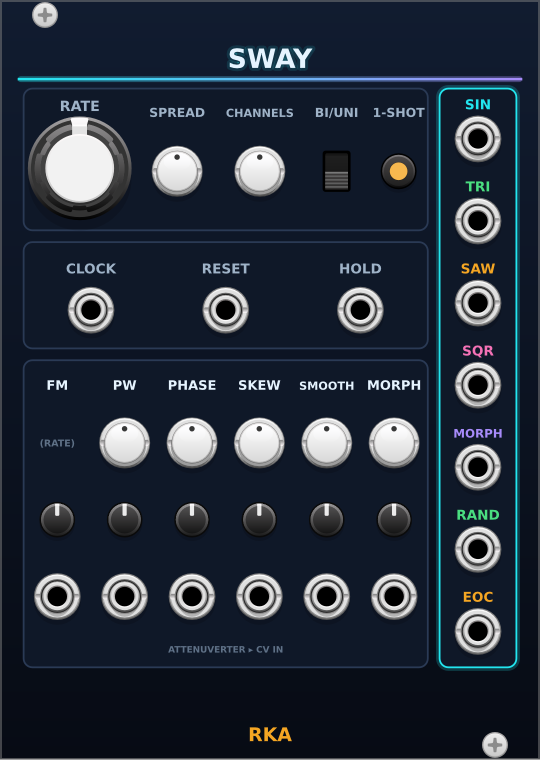

# Sway

Polyphonic LFO, 18 HP: four classic waves, a shapeable MORPH wave, a random
output from stepped to gliding, an end-of-cycle trigger, clock sync, phase spread across channels, and a one-shot
mode that turns it into an envelope.

## Rate and timing

- **RATE**: the LFO's speed. Its range is set in the right-click menu:
  - **Slow**: 4.5 hours to 1 second per cycle (2⁻¹⁴ to 1 Hz), for drift.
  - **Normal** (default): 0.008 Hz to 128 Hz. Default 2 Hz.
  - **Audio**: about 8 Hz to 8 kHz, centred on C4. SAW, SQR and MORPH's
    square are band-limited in this range.

  The tooltip shows Hz, or the cycle time in Slow.
- **FM** jack and attenuverter: exponential FM added to RATE, 1 V/oct at
  full clockwise, inverted counter-clockwise, off at centre.
- **CLOCK**: once two clock edges have arrived, RATE becomes a ratio of
  LFO cycles per clock: ÷16 ÷12 ÷8 ÷6 ÷4 ÷3 ÷2 ×1 ×2 ×3 ×4 ×6 ×8 ×12 ×16
  (centre is ×1; the tooltip shows the ratio). FM then moves the ratio one
  step per volt. The cycle restarts on every clock edge (×N) or every Nth
  edge (÷N). Unplug the clock to run free again.
- **RESET**: a rising edge (above 1 V) restarts the cycle at phase 0 and
  restarts the ÷N count.
- **HOLD**: while high (above 1 V), the LFO freezes where it is.
- **1-SHOT** (amber when on): RESET runs a single cycle, then the outputs
  rest at the cycle's end until the next RESET, so Sway works as an
  envelope. Clock edges set its speed but never restart it.

## Shape

- **PW**: pulse width of SQR and of MORPH's square, 1% to 99%.
- **PHASE**: shifts every output by 0–360°.
- **SKEW**, **SMOOTH**, **MORPH** shape the MORPH output (SMOOTH also
  sets the RAND output's curve):
  - **MORPH** sweeps sine → triangle → saw → square.
  - **SKEW** sets how much of the cycle the rise takes: 50% is
    symmetric; the ends turn the sine and triangle into falling (0%) and
    rising (100%) ramps.
  - **SMOOTH**: left of centre rounds the shape's corners; right of centre
    wavefolds it, up to three folds. For RAND, centre and right are
    stepped, and turning left makes each new value glide in, over the whole
    cycle when fully left.
- Each of FM, PW, PHASE, SKEW, SMOOTH and MORPH has a CV jack with an
  attenuverter; ±5 V at full sweeps the whole knob range.
- **BI / UNI**: every output swings ±5 V (bipolar) or 0–10 V (unipolar).

## Polyphony

- **CHANNELS** (1–16) sets how many channels Sway outputs. A polyphonic
  cable into any input raises it to that cable's channel count.
- **SPREAD** offsets each channel's phase: at 0 all channels move together;
  at 100% they are evenly spaced around the cycle. Patch a poly output to
  16 voices for 16 related but different modulations.
- Each channel has its own random values, clock follower and reset/hold
  detection; a mono cable drives every channel.

## Outputs

| Output | Wave |
|---|---|
| SIN, TRI | Sine and triangle, starting at 0 V rising, in phase with each other |
| SAW | Rises over the cycle, drops at its end |
| SQR | Square with pulse width PW |
| MORPH | The shaped wave (MORPH, SKEW, SMOOTH, PW) |
| RAND | A new random value each cycle: stepped, or gliding in as SMOOTH turns left |
| EOC | A 10 V, 1 ms trigger at the end of each cycle (including a finished one-shot and a clock restart; not RESET) |
