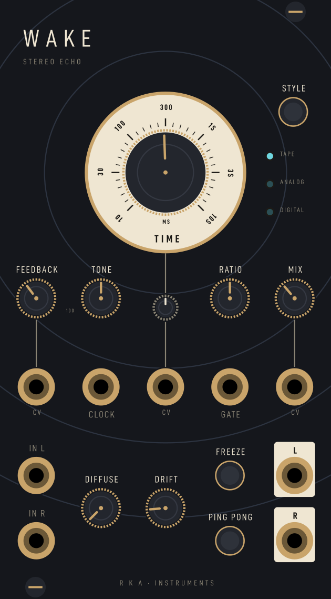

# Wake

A stereo echo, 14 HP: what a passing sound leaves behind it. Wake goes
after a struck sound (Rigging's strikes, a ping, a bell) and gives each hit
depth, space and a rhythm of repeats, in one of three characters: **Tape**,
**Analog** or **Digital**.

## The panel

From the top:

- **TIME**, on the enamel dial, lettered in milliseconds and seconds, with
  its attenuverter and **CV** input straight under it.
- **STYLE**, a button to the right of the dial. Each press steps to the
  next of the three lights: **TAPE**, **ANALOG**, **DIGITAL**.
- **FEEDBACK**, **TONE**, **RATIO** and **MIX**. Feedback and Mix each
  have a **CV** input under them, joined by a line. The small **100** by
  Feedback marks 100 %.
- **CLOCK** and **GATE** (freeze) inputs, between the CVs.
- **IN L** and **IN R**; **DIFFUSE** and **DRIFT**; the **FREEZE** and
  **PING PONG** buttons; and on ivory tiles the **L** and **R** outputs.

## Controls

### Time: the echo time

Time runs from **10 ms to 10 s**. The scale is logarithmic, so the useful
100 ms to 3 s takes up the middle of the travel. It opens at 300 ms. The
tooltip shows the time; you can type one in ("250", "250 ms" or "1.5 s").

The **CV** adds to the knob in octaves: with the attenuverter fully right,
1 V doubles the time, so ±5 V covers the whole range from noon. Fully left
it is inverted. The attenuverter opens at 0, so a newly patched CV does
nothing until you turn it up.

What you hear when Time moves depends on the style (below). It never
clicks.

### Clock: echoes in time

Patch a clock into **CLOCK** (Squall's Gate, any clock) and Time stops
being milliseconds: the knob picks a **multiple of the clock's period**,
in ten steps:

**1/4, 1/3, 1/2, 2/3, 3/4, ×1, ×1.5, ×2, ×3, ×4**

Noon is ×1: one echo per clock tick. The tooltip shows the step.

- The tempo is taken from the time between the last two ticks, so it
  follows a clock that changes.
- A clock that pauses and starts again keeps its tempo: a gap of more
  than four ticks is not taken for a tick. (A clock that really slows by
  more than that is followed one tick late.)
- Time's CV moves along the same steps, so a clocked echo is always on the
  clock's grid.
- If the result would be longer than 10 s it is halved until it fits; if
  shorter than 10 ms, doubled.
- If the clock stops, the last tempo holds. Unplug it and the knob is
  milliseconds again; plugged back in, it needs two ticks to be followed.

### Ratio: the two sides

Ratio sets the left and right echo times against each other. It has seven
steps:

| Knob | Left | Right |
|---|---|---|
| fully left | 1/2 of Time | Time |
| | 2/3 of Time | Time |
| | 3/4 of Time | Time |
| **noon** | Time | Time |
| | Time | 3/4 of Time |
| | Time | 2/3 of Time |
| fully right | Time | 1/2 of Time |

At noon both sides echo together. Off noon the two sides fall into a
rhythm against each other, and the echoes spread across the stereo field.
The tooltip names the step ("R 2:3" is the right side at two thirds of the
left).

### Feedback: how many repeats

At 0 there is one echo. Turning up feeds each echo back in to make the
next. The knob runs to **110 %**, and the tooltip shows the percentage.

- **Below 100 %** the repeats die away. Tone and the style also take a
  little off every pass, so Tape and Analog die away sooner than Digital
  at the same setting.
- **From 100 % up** the repeats sustain or grow. The loop has a soft
  ceiling, so this never runs away: it settles into a held, saturated
  wash.

The **CV** adds to the knob: 10 V is its full travel.

### Tone: how the repeats change

Tone is a filter inside the loop, so its effect adds up with every repeat.

- **Noon:** flat. Repeats keep their tone.
- **Left:** each repeat is darker than the last (down to about 500 Hz at
  the end of the travel).
- **Right:** each repeat is thinner than the last (losing lows up to about
  1 kHz).

### Style: three characters

Each press of **STYLE** steps Tape, Analog, Digital and round again. The
change is smooth, with no click. It opens on Tape.

| | When Time moves | The repeats |
|---|---|---|
| **Tape** | Pitch bends up or down and settles, as a tape machine changing speed | Gently saturated; each pass loses a little top (above about 6 kHz) and bottom |
| **Analog** | Pitch bends, a little faster than Tape | Darker, and darker still as Time gets longer (about 5 kHz at short times, 1.5 kHz at a second and beyond); driven harder, so repeats turn gritty |
| **Digital** | The echo crossfades to the new time: no bend | Clean and full; only Tone changes them |

A pitch bend never goes further than two octaves either way. In Digital a
very small change of time (a few samples, as from a slow, shallow CV) is
slid, not crossfaded, which bends pitch by a hair.

### Diffuse: sinking back

Diffuse smears each pass through the loop, so repeats blur further each
time round and the echo turns toward a wash. At 0 it is out of the path
and repeats are exact. It does not change the repeats' level, and each
smeared repeat stays centred on its echo time. Turning it up from exactly
0 shifts the echo by a few milliseconds as it comes in.

### Drift: slow movement

Drift makes each side's echo time waver slowly, as a tape machine's speed
does, so repeats move a little in pitch and the two sides separate. The
two sides wander independently.

- At 0 nothing moves, in any style. It opens at 15 %.
- Long echoes waver more than short ones: at full, up to about 30 cents on
  echoes of a few seconds, about 15 cents at 300 ms, and only a few cents
  at 50 ms.

### Freeze

Press **FREEZE**, or send a gate to **GATE**, and Wake holds what is in
the delay: each side loops the last stretch it recorded, as long as its
echo time, for as long as you like. The button lights while frozen, by
either means.

- Nothing new goes into the delay. The input still passes to the output
  through Mix.
- The frozen sound is exactly the echo that was playing, and it does not
  fade, dull or build. Feedback, Tone, Diffuse and Style have no effect
  on it while it is held.
- **Time, Ratio, the clock and Ping Pong are held** while frozen. Changes
  you make take effect when you release.
- Drift still acts, so a frozen sound is not perfectly static. Turn Drift
  to 0 for an exact loop.
- Freezing is seamless; releasing fades back over a few hundredths of a
  second. A freeze asked for while Time is still crossfading (Digital), or
  just after a release, waits for that fade to finish: 40 ms at most.

The button's state is saved with the patch; the sound in the delay is not.

### Ping Pong

With **PING PONG** on, echoes bounce: left, right, left.

- The input goes into the left side only (both inputs, mixed).
- The left side's echo feeds the right side; the right side's feeds back
  to the left through Feedback.
- At Feedback 0 you get one echo on the left and one, as loud, on the
  right. Feedback sets how each left-right pair falls against the one
  before.
- With Ratio off noon the bounce has a long-short rhythm.

With Ping Pong off, each side feeds itself and a stereo input stays
stereo.

### Mix

From the input alone (fully left) to the echoes alone (fully right), at
equal power. It opens at 35 %. Fully left is the input exactly. The **CV**
adds to the knob: 10 V is its full travel.

## Inputs and outputs

- **IN L, IN R:** either one alone feeds both sides. A polyphonic cable is
  summed.
- **CV inputs** use a polyphonic cable's first channel.
- **L and R:** every output has a soft limit that starts at 8 V and never
  passes 10 V.
- **L alone is a mono out:** with nothing in R, L carries the average of
  the two sides. One cable in, one cable out, Mix fully left is exactly
  the input.

## Patches to try

- **Depth behind a strum.** Squall's Gate into Rigging's STRUM, Rigging
  into Wake. Tape, Time about 400 ms, Feedback 40 %, Ratio one step right,
  Mix 30 %. Each strike trails off to one side.
- **Echoes on the clock.** The same clock into Squall and into Wake's
  CLOCK. Time at ×1.5 or 3/4 puts the echoes between the hits.
- **A bounce.** Ping Pong on, Ratio two steps left, Feedback 60 %,
  Digital. A single hit becomes a long-short pattern crossing the field.
- **A wash.** Analog, Time 2 s, Feedback 85 %, Diffuse 70 %, Tone a little
  left. Hits dissolve into a dark cloud; follow it with Fog.
- **Hold a moment.** Send a slow gate from Squall into GATE. Wake catches
  whatever was passing and holds it until the gate ends.
- **Tape slur.** Tape, Feedback 70 %, and a slow Sway into Time's CV with
  the attenuverter barely open. The repeats bend around the note.
- **Self-sustaining drone.** Feedback above 100 % with a short Time and
  Tone left: one hit becomes a held tone at the echo's pitch. Bring
  Feedback down to let it go.

## Bypass

Bypassed, the inputs pass straight to the outputs, routed as when Wake
is working: either input alone goes to both, and with nothing in R, L
carries the average of the two. The style light stays lit.

## Other details

- **The longest echo is 10 s** at sample rates up to about 200 kHz. Above
  that the delay's memory is the limit: about 5.5 s at 384 kHz and 2.7 s
  at 768 kHz.
- What goes into the delay is limited to ±24 V.
- A change of sample rate, and Initialize, empty the delay and unfreeze.
- Saved with the patch: the knobs, Style, Freeze and Ping Pong.
- Randomize does not touch Freeze or Style.
- CPU: about 0.15 % of a core at 48 kHz.
