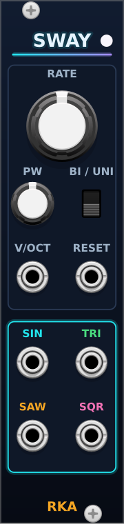

# Sway

Polyphonic LFO, 6 HP.

- **RATE**: 0.008 Hz to 128 Hz, exponential. Default 2 Hz.
- **PW**: pulse width of the square, 1% to 99%.
- **BI / UNI**: outputs swing ±5 V (bipolar) or 0–10 V (unipolar).
- **V/OCT**: added to RATE; +1 V doubles the rate.
- **RESET**: a rising edge (above 1 V) restarts the cycle at phase 0.
- **SIN, TRI, SAW, SQR**: sine and triangle start at 0 V rising and stay in
  phase with each other. The saw rises and drops at the end of the cycle.
- The LED shows the sine of channel 1: cyan positive, magenta negative.
- Polyphonic: the channel count follows the widest of V/OCT and RESET. A mono
  cable drives every channel.
